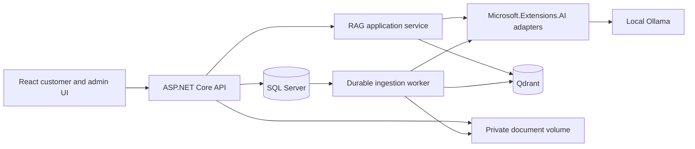

# Architecture and decisions

## Topology



Use a modular monolith with one API deployment and a hosted worker initially. Persist jobs in SQL so restarts do not lose uploads. Do not hold request connections open for document indexing. Keep services replaceable through interfaces, without adding a separate microservice for every responsibility.

## Planned repository layout

```text
src/
  HavenSupport.Api/             HTTP, authentication, rate limits, composition
  HavenSupport.Application/     chat, ingestion, ticket and feedback use cases
  HavenSupport.Domain/          entities, states, business constraints
  HavenSupport.Infrastructure/  EF, SQL jobs, Qdrant, Ollama, PdfPig, file storage
  haven-support-web/            React/Vite/TypeScript/Tailwind
tests/
  HavenSupport.UnitTests/
  HavenSupport.IntegrationTests/
  HavenSupport.Evaluation/
  browser/                     Playwright user journeys and accessibility
deploy/                        Dockerfiles, compose, health checks
scripts/                       setup verification, seed and evaluation commands
docs/                          specifications, fixtures and reports
```

Domain has no provider dependencies. Application references Domain; Infrastructure implements Application ports; API composes both. Frontend calls versioned HTTP contracts rather than database/provider services.

## Stack decisions

| Area | Decision | Implementation proof required |
| --- | --- | --- |
| Backend | .NET 10 LTS, ASP.NET Core, C#, EF Core SQL Server provider | Build/migrate using locked compatible package versions |
| Frontend | React, TypeScript strict mode, Vite, Tailwind | Lock exact versions and compatible Node; use the chosen Tailwind major's actual setup |
| AI abstractions | `IChatClient` and `IEmbeddingGenerator<string, Embedding<float>>` | Confirm signatures and Ollama adapter compatibility against installed packages |
| Ollama adapter | Prefer a maintained compatible adapter; otherwise a narrow tested HttpClient adapter implementing these abstractions | Schema output, embeddings, cancellation, errors, token limits verified against real local Ollama |
| Retrieval | Qdrant official .NET client, cosine similarity, model-specific collection | Real upsert/search/filter/delete integration test |
| PDF | PdfPig, page-aware extraction | Two-column PDF, line wrapping, textless and damaged PDF fixtures |
| Auth | Identity user/password/roles plus explicitly issued signed JWT access tokens | Issuer/audience/signature/lifetime/role verification and refresh tests |
| UI data | React Router; TanStack Query for server state; local component state for drafts | Invalidation, navigation and retry behavior verified |
| Forms | Accessible labeled inputs; schema validation shared in intent with server validators | Server remains authoritative |
| Testing | xUnit + WebApplicationFactory, real SQL/Qdrant integration services; Vitest/React Testing Library; Playwright | No SQLite replacement for SQL-specific behavior |
| Local operation | Docker Compose supporting services, optional full-stack profile | Health checks, persistence and restart rehearsal |

## Reliable chat transport

Use a durable turn request: POST creates a request and returns 202; the UI polls its status using an authenticated GET until it reaches a terminal state. Show stage updates, not unvalidated model tokens. Poll about once per second initially, back off when hidden, stop on completion/unmount, and resume from the stored request ID after reload. This avoids leaking draft unsupported claims and provides retry/reconnect semantics. Token streaming is a later enhancement after grounded output can be safely validated.

Use a SQL lease for chat work as well as ingestion. A crashed worker's expired lease is recoverable; completed turn results are unique by request ID. A request started with stale knowledge is revalidated before completion. Limit queue depth and expose overload rather than accepting unbounded work.

## Versioning and deployment

Pin SDK with `global.json`, NuGet versions centrally with lock files, frontend lockfile, and exact image/model identifiers. Model, prompt, chunker, and retrieval configuration versions are part of each evaluation and chat trace. Verify licenses for adapters, model weights, PdfPig, and container dependencies before redistribution.

Use one origin for production frontend/API via reverse proxy. Vite uses an API proxy for development. SQL, Qdrant, and Ollama are internal dependencies, never browser endpoints. SQL and Qdrant have independent persistence; application logic reconciles them rather than pretending to have a distributed transaction.
